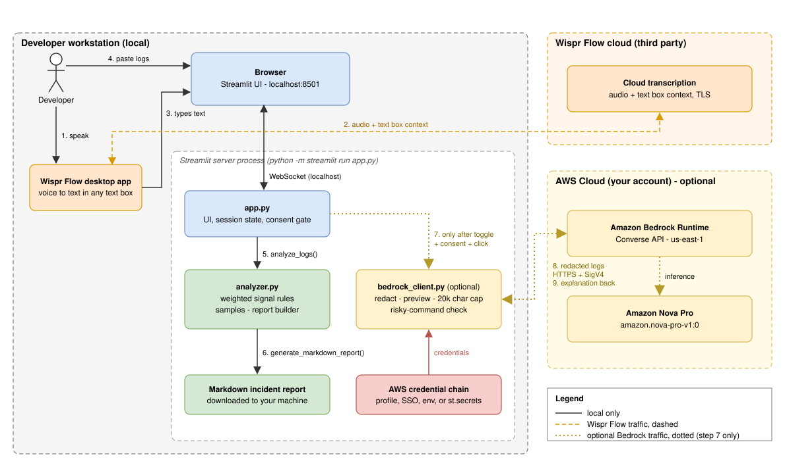

# VoiceOps AI

VoiceOps AI helps developers understand AWS-style incident logs and find safe troubleshooting steps. Paste or dictate logs, and it reports:

- the likely error type and a severity estimate
- the matching evidence
- possible causes
- read-only diagnostic steps

You can download all of this as a Markdown incident report.

Built for the WeMakeDevs x Wispr Flow No Hands Challenge.

## Features

- Paste logs into a multiline text area, dictate them with Wispr Flow, or load a sample incident.
- Detects four error categories with local Python rules:
  - AWS Lambda timeout
  - IAM access denied
  - API throttling / rate limiting
  - Database connection failure
- Shows the detected error type, severity (rule-based estimate), confidence, matched signals, matching log lines, possible causes, and recommended diagnostic steps.
- Handles unrecognized errors honestly: no root cause is invented, only general triage steps are shown. Matches based only on generic text are marked as tentative.
- Downloads a Markdown incident report.
- Optional: an AI explanation from Amazon Nova on Amazon Bedrock, sent only when you opt in and click.

## Architecture



The editable source is [`docs/architecture.drawio`](docs/architecture.drawio). Open it in [draw.io](https://app.diagrams.net) (File > Open from > Device) or in the draw.io extension for VS Code. `docs/architecture.svg` is a hand-maintained copy so GitHub can show the diagram inline. If you change one file, update the other.

### Trust zones

| Zone | What runs there | What leaves it |
| --- | --- | --- |
| Developer workstation (local) | Browser, Streamlit server, `app.py`, `analyzer.py`, `bedrock_client.py`, downloaded reports | Nothing by default |
| Wispr Flow cloud (third party) | Speech-to-text transcription | Your voice audio and nearby text box content, only while you dictate |
| AWS Cloud (your account, optional) | Amazon Bedrock Runtime and Amazon Nova 2 Lite | Redacted logs, only after step 7 |

### Components

| Component | Responsibility |
| --- | --- |
| Browser | Renders the Streamlit dashboard at `localhost:8501`. All input arrives here as ordinary keyboard text, whether typed, pasted, or dictated. |
| Wispr Flow desktop app | Optional voice input. Turns speech into text in whichever text box has focus. VoiceOps AI has no Wispr Flow integration or API key; it only sees the typed text. |
| `app.py` | UI only: layout, session state, buttons, the Bedrock opt-in toggle and consent gate, and the report download. |
| `analyzer.py` | The detection engine. Scores each category with weighted signals and context, picks the best match, and sets confidence (see [How detection works](#how-detection-works)). Also holds the sample incidents and builds the Markdown report. No network access. |
| `bedrock_client.py` | Optional. Redacts the logs, builds a preview, caps the size, calls the Bedrock Converse API, and scans the reply for state-changing AWS CLI commands. boto3 is imported only when this runs. |
| AWS credential chain | Standard boto3 credential sources (`aws configure`, `aws login`, SSO, environment variables). VoiceOps AI never stores credentials. |
| Amazon Bedrock and Amazon Nova | Generate the optional plain-language explanation in your own AWS account. |

### Data flow

The numbers match the diagram.

1. **Speak (optional).** You hold the Wispr Flow hotkey and speak.
2. **Transcribe (optional).** Wispr Flow sends the audio, plus context from the focused text box, to Wispr's cloud over TLS and gets text back.
3. **Type.** Wispr Flow types the transcript into the focused field.
4. **Paste.** You can also paste logs from CloudWatch, a terminal, or a file. This is the usual path for full logs.
5. **Analyze.** Clicking **Analyze logs** calls `analyze_logs()` in the same Python process. No network access.
6. **Report.** `generate_markdown_report()` builds the report, and the browser downloads it to your machine.
7. **Opt in (optional).** This step only happens when all of the following are true:
   - Bedrock is enabled in the sidebar.
   - The logs have been analyzed.
   - You reviewed the preview, ticked the consent box, and clicked **Explain with Bedrock**.

   Consent resets on every new analysis.
8. **Send.** `bedrock_client.py` sends the redacted, size-capped logs to the Bedrock Converse API over HTTPS, signed with SigV4.
9. **Explain.** The reply is checked locally for risky commands, then shown in the UI and included in the report.

### How detection works

Each rule in `analyzer.py` has two kinds of patterns:

- **Signals** are error-message patterns.
  - Strong signals are specific enough on their own, such as `ThrottlingException` or `Task timed out after 30.01 seconds`. Each scores 3.
  - Weak signals are generic text, such as `Connection refused`. Each scores 1.
- **Context** patterns are surrounding clues, such as database ports, `.rds.amazonaws.com` hostnames, or Lambda `REPORT` lines. They add up to 2 points, but only when a signal already matched. Context alone never triggers a detection.

Each signal is counted once, however many lines it matches. The highest score wins. Ties go to the category with a strong signal, then to the higher severity.

Confidence works like this:

| Confidence | When |
| --- | --- |
| High | A strong signal matched, or the score is 4 or more |
| Medium | Score of 2 or 3 |
| Low | Anything less. Shown as tentative. |
| None | Nothing matched. The error is reported as unrecognized. |

## Setup

### Prerequisites

- Python 3.10 or newer. Development and testing used Python 3.13.
- Optional: an AWS account with Amazon Bedrock access, for AI explanations.
- Optional: the [Wispr Flow](https://wisprflow.ai) desktop app, for voice input.

### 1. Run the core app (no cloud services)

```powershell
python -m venv .venv
.venv\Scripts\Activate.ps1        # macOS/Linux: source .venv/bin/activate
pip install -r requirements.txt   # the -r flag is required
streamlit run app.py
```

Open http://localhost:8501, choose a sample in the sidebar, click **Load sample**, then **Analyze logs**.

`requirements.txt` installs Streamlit and boto3. boto3 is only loaded when you use the optional Bedrock feature, so the core analyzer works without AWS credentials.

If you see `No matching distribution found for requirements.txt`, the `-r` flag is missing. Without it, pip looks for a package literally named "requirements.txt".

### 2. Optional: enable Amazon Bedrock explanations

1. Make AWS credentials available through the standard chain, for example `aws configure`, `aws login`, or `aws sso login`. Check which identity is active with `aws sts get-caller-identity`.

2. Grant only the permission the app needs. The default model is a cross-Region inference profile, so the policy needs both the profile and the underlying foundation model. Replace `<account-id>`:

   ```json
   {
     "Version": "2012-10-17",
     "Statement": [
       {
         "Sid": "VoiceOpsInvokeNova",
         "Effect": "Allow",
         "Action": "bedrock:InvokeModel",
         "Resource": [
           "arn:aws:bedrock:us-east-1:<account-id>:inference-profile/us.amazon.nova-2-lite-v1:0",
           "arn:aws:bedrock:*::foundation-model/amazon.nova-2-lite-v1:0"
         ]
       }
     ]
   }
   ```

3. Start the app, turn on **Enable AI explanation** in the sidebar, analyze logs, then use the panel under the results.

The defaults are model `us.amazon.nova-2-lite-v1:0` in Region `us-east-1`. Override them in the sidebar or with environment variables:

```powershell
$env:VOICEOPS_BEDROCK_MODEL_ID = "us.amazon.nova-pro-v1:0"
$env:VOICEOPS_BEDROCK_REGION = "us-east-1"
```

If you change the model, update the policy resources to match. Bedrock calls are billed to your AWS account.

### 3. Optional: voice input with Wispr Flow

1. Install Wispr Flow from [wisprflow.ai](https://wisprflow.ai), sign in, and grant microphone access when prompted.
2. Before dictating anything work-related, review **Settings > Data and Privacy**. See [Wispr Flow](#wispr-flow) under Security notes.
3. Click into the **Incident logs** box in VoiceOps AI, hold your Wispr Flow dictation hotkey (shown in the Wispr Flow app), and speak.
4. Click **Analyze logs**.

Tips for voice input:

- Dictation works best for short error messages you are reading from another screen, for example: "Task timed out after thirty seconds".
- For full logs, paste instead. Dictation can change exact error codes. For example, "throttling exception" only matches a generic signal, while the exact `ThrottlingException` matches a strong one. The analyzer is case-insensitive, but it can't rebuild a code that was split into separate words.
- If you dictate AWS error codes often, add them (`ThrottlingException`, `AccessDenied`, `Sandbox.Timedout`) to your Wispr Flow dictionary so they come out exactly.

## Security notes

### Core analyzer

- Runs fully locally with Python regex rules. No AWS credentials, no AI API key, and no network calls.
- Never executes commands and never changes AWS resources. Suggested CLI commands are read-only checks (`get-*`, `describe-*`, `list-*`, `simulate-principal-policy`) for you to review and run yourself. A test checks that no built-in step contains a state-changing command.
- Severity, causes, and confidence are heuristics, not confirmed root causes.
- Input is capped at 500,000 characters, and evidence lines are clipped, to keep analysis bounded.
- `.streamlit/config.toml` binds the server to `localhost` and turns off Streamlit usage statistics. Streamlit's own default listens on all network interfaces. The app has no authentication, so don't override `server.address` on a shared network.
- Downloaded reports contain log excerpts. Treat them like the logs themselves. `.gitignore` excludes `voiceops-incident-*.md` and `*.log`.

### Amazon Bedrock (optional)

- Off by default. boto3 is installed but only imported when you click **Explain with Bedrock**.
- Nothing is sent until you enable it, review the preview, tick the consent box, and click **Explain with Bedrock**. Consent resets for every new analysis.
- Before sending, the app redacts access key IDs, `password=`/`secret=`/`token=` values, bearer tokens, emails, IPv4 addresses, and 12-digit account IDs by default. Redaction is pattern-based and won't catch everything, so always check the preview.
- At most 20,000 characters are sent. Output is capped at 1,024 tokens.
- The prompt marks the logs as untrusted data and asks for read-only steps only. The model can still ignore this; in testing, Nova suggested `aws lambda invoke`. The reply is therefore scanned locally, and state-changing AWS CLI commands are flagged in the UI and the report.
- Credentials come only from the standard AWS credential chain. Nothing is hardcoded or stored. Use the least-privilege policy above.

### Wispr Flow

VoiceOps AI doesn't integrate with Wispr Flow. Wispr Flow is a separate desktop app that types text for you, so its data handling is governed by Wispr's settings, not by VoiceOps AI. The points below summarize Wispr's [Data Controls page](https://wisprflow.ai/data-controls) (last updated August 18, 2026). Check it for current details.

- **Transcription always runs in Wispr's cloud.** Your audio and transcripts leave your machine whenever you dictate, encrypted with TLS in transit and at rest.
- **Surrounding text is used as context.** Wispr reads content in the text box you dictate into to fix capitalization and punctuation. If you dictate into the **Incident logs** box after pasting logs there, parts of those logs may be sent to Wispr. Click **Clear** first, or don't dictate into a box that already holds sensitive logs.
- **Context Awareness** (Settings > Data and Privacy) can send text from the active app window. Turn it off while sensitive logs are on screen.
- **Model training:** you control whether your audio, transcripts, and edits can be used to improve models, in Settings > Data and Privacy. This setting used to be called "Privacy Mode". Turn it off for work data.
- **Dictation Cloud Storage** controls whether Wispr keeps your transcripts, audio, and history on its servers. Turn it off if you don't need cross-device history.
- **Feedback** (ratings, thumbs up or down) sends data from that session, which may include audio and transcripts, for review. Avoid it on sessions that included incident details.
- **Never dictate secrets.** VoiceOps AI's redaction only applies to text sent to Bedrock. It can't protect anything you have already spoken to Wispr Flow.
- Follow your organization's policy on third-party dictation tools. Enterprise plans have data sharing turned off.

## Running tests

```powershell
pip install -r requirements-dev.txt
python -m pytest
```

The tests cover:

- every supported error category, using the bundled samples plus extra log variants and real-world formats
- confidence levels, false positives, the MySQL-versus-IAM case, and scoring rules
- unknown and empty input, and logs that mix categories
- report generation, and a check that built-in commands are read-only
- redaction, and the Bedrock request format and error handling, using a fake client with no network calls
- risky-command detection
- headless UI tests with `streamlit.testing`, including the Bedrock consent gate

## Project structure

```text
analyzer.py                   Rule-based detection, sample incidents, Markdown report
bedrock_client.py             Optional Bedrock explanation, redaction, risky-command check
app.py                        Streamlit dashboard (UI only)
docs/architecture.drawio      Editable architecture diagram (draw.io)
docs/architecture.svg         Rendered diagram shown in this README
.streamlit/config.toml        Binds to localhost, disables usage statistics
tests/test_analyzer.py        Analyzer and report tests
tests/test_bedrock_client.py  Bedrock integration tests (no network)
tests/test_app.py             Headless Streamlit UI tests
requirements.txt              Runtime dependencies (Streamlit, boto3)
requirements-dev.txt          Test dependencies
```

## Adding a new error category

Add a `Rule` to `RULES` in `analyzer.py` with `signals`, optional `context`, `causes`, and read-only `steps`. Then add a sample to `SAMPLE_INCIDENTS` and test cases in `tests/test_analyzer.py`.

- Use `strong(...)` for messages that identify the category on their own, such as an AWS error code.
- Use `weak(...)` for generic text that only hints at it.
- Context patterns (ports, hostnames, library names) add weight only when a signal already matched.

## License

Released under the [MIT License](LICENSE).
